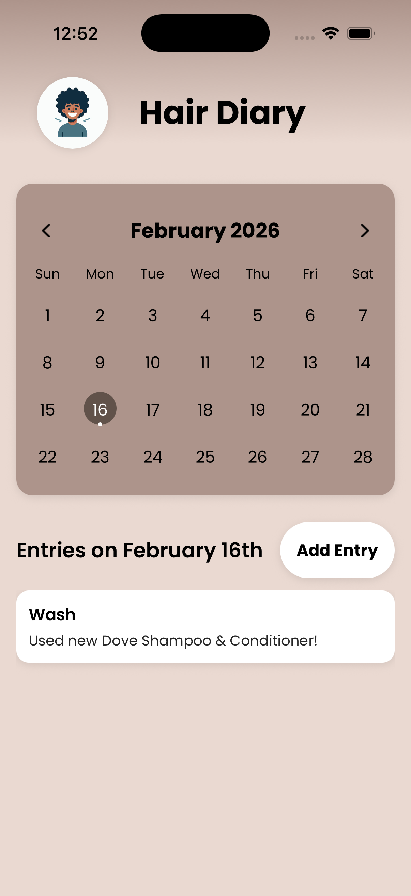
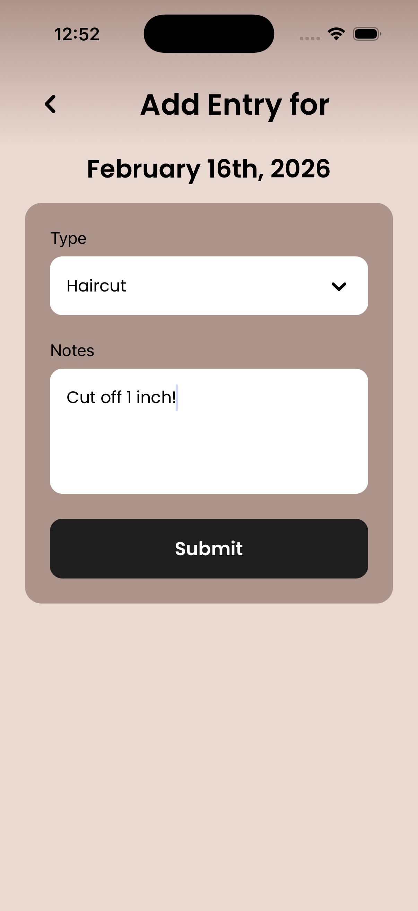
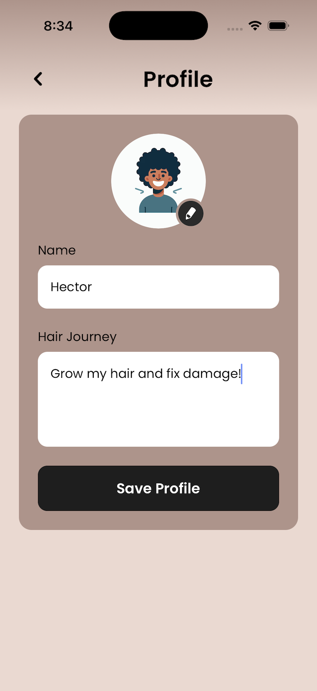

# 💇‍♀️ Hair Diary

An app designed to empower people embrace their hair care in an easy and visual way. It helps track hair care routines, products, and styles. Built with React Native and TypeScript, it helps people achieve their goals of their hair care journey.

## ⚙️ Tech Stack

**Core Technolgies**
- React Native
- TypeScript
- Expo
- Supabase

**Front-End Libraries**
- **React Navigation** - Screen navigation and routing.
- **react-native-calendars** - Interactive calendar component w/ custom styling
- **expo-linear-gradient** - Gradient background
- **expo-font** - Customer typography
- **expo-image-picker** - Profile picture uploads

**Back-End & Database**
- **Supabase Auth** - User authentication & session management
- **Supabase Database (PostgreSQL)** - Relational database w/ RLS policies
- **Supabase Storage** - Cloud storage for Profile Pictures 

## 🏗️ File structure
```
hair-diary/
├── screens/
│   ├── HomeScreen.tsx        # Calendar and entries display
│   ├── AddEntryScreen.tsx    # Entry creation
│   ├── ProfileScreen.tsx     # User profile management
│   └── LoginScreen.tsx       # Authentication
├── lib/
│   ├── supabase.ts           # Supabase client configuration
│   ├── supabaseEntries.ts    # Entry operations
│   └── supabaseProfile.ts    # Profile and storage operations
├── components/
│   ├── form/                 # Reusable form components
│   ├── HeaderGradient.tsx    # Background gradient header component
│   └── ScreenHeader.tsx      # Navigation header
├── utils/
│   ├── dateFormat.ts         # Date formatting utilities
│   └── todayISO.ts           # Date helper functions
└── assets/
    └── fonts/                # Poppins font family
```

## 📋 Prerequisites

Before you begin, ensure you have the following installed.

### Required Software

- **Node.js** (v14.0 or higher)
- **npm** (v6.0 or higher) or **yarn**
- **Git**

## Installation

Once you have the prerequisites installed, follow these steps:

1. **Clone the repository**
```
bash
git clone https://github.com/hecbatista/hairdiary.git
cd hairdiary
```

2. **Install dependencies**
```
bash
npm install
```
or
```
bash
yarn install
```

3. **Start the development server**
```
bash
npm start
```
or
```
bash
npx expo start
```


## 📸 Preview
<p align=center>
    
    
    
</p>

## 🎯 Features
- **User Authentication** - Secure login
- **Calendar-Based Tracking** - Visual interface w/ marked dates
- **Custom Entry Logging** - Record daily routines, styling, and treatments
- **Cloud Data Storage** - Entries sync across devices w/ Supabase
- **Profile Managment** - Upload profile pictures to cloud storage

## 🌟 Final App Goal
A polished, well-engineered iOS app that helps **anyone** caring for their hair understand what works for them. Users log their routines, products, and photos, see their progress and trends over time, share Good Hair Days with a community, and get smart, personalized recommendations to improve their hair health.

The app is shipped as a **TestFlight beta** and doubles as a portfolio project showcasing full-stack mobile development: clean architecture, tested code, CI, and a version-controlled Supabase backend.

## 🥅 Goals
- Develop Front-End Skills w/ React-Native
- Develop Back-End Skills w/ Supabase and Expo Routing
- Improve upon code design and documentation
- Learn cloud storage and database integration
- Practice professional workflows: testing, CI, and sprint planning w/ GitHub Projects
- Implement machine learning recommendations (LLM-powered and classic ML)

## 🗺️ Roadmap
Work is planned in 2-week sprints on the [Hair Diary Roadmap](https://github.com/users/hecbatista/projects/1) project board, with one ticket per item below. Phases are ordered by priority.

### Phase 1 — Foundation *(Sprint 1)*
- [ ] **Lint & format** - ESLint + Prettier
- [ ] **Refactor & types** - Typed navigation (no `any`), consistent error handling w/ user feedback
- [ ] **Backend setup** - Supabase CLI w/ migrations & RLS policies in repo, local dev + seed data, generated DB types, env & secrets config
- [ ] **Tests** - Jest + React Native Testing Library for components and `lib/` functions
- [ ] **CI pipeline** - GitHub Actions running typecheck, lint, and tests on PRs
- [ ] **Claude Code setup** - `CLAUDE.md` and project skills for AI-assisted development
- [ ] **Edit & delete entries**
- [ ] **Photos on entries** - Attach progress photos via Supabase Storage

### Phase 2 — Accounts & Onboarding
- [ ] **Sign up flow** - Email sign up & password reset
- [ ] **OAuth** - Sign in with Apple / Google
- [ ] **Hair profile quiz** - Hair type, porosity, density, and goals during onboarding
- [ ] **Settings & account** - Edit profile, dark mode, data export, delete account

### Phase 3 — Richer Diary
- [ ] **Product shelf** - Save the products you own and use
- [ ] **Products used** - Tag products on each entry
- [ ] **Richer entry fields** - Hair rating/mood, tags, routine steps, weather/humidity

### Phase 4 — Insights
- [ ] **Progress timeline** - Photo gallery w/ before & after comparisons
- [ ] **Stats & trends** - Wash frequency, streaks, products linked to Good Hair Days
- [ ] **Goals tracking** - Set journey goals and track progress
- [ ] **Reminders** - Push notifications for wash days, masks, and trims

### Phase 5 — Community
- [ ] **Good Hair Day posts** - Share posts w/ the products used
- [ ] **Community feed** - Browse posts from others
- [ ] **Likes & follows**
- [ ] **Reporting & moderation**

### Phase 6 — Smart Recommendations
- [ ] **Data consent & collection** - Opt-in data for training & recommendations
- [ ] **LLM recommendations** - Personalized routine/product advice via a Supabase Edge Function
- [ ] **Classic ML model** - Research & train a model on routine/product outcomes once enough data exists

### 🚀 Release
- [ ] **TestFlight beta** - EAS Build & submit, app icon, splash screen, privacy policy

## 🧑🏽‍💻 About me
Built by Hector Batista (a fellow curly head!) - Computer Science & Business Administration

I'm passionate about learning new things while also helping people easily achieve their goals through software solutions.

**Connect with me:**
- 🧳 LinkedIn: [Hector Batista Jr](https://www.linkedin.com/in/hectorbatistajr/)
- 📧 Email: [batista.h@northeastern.edu](mailto:batista.h@northeastern.edu)